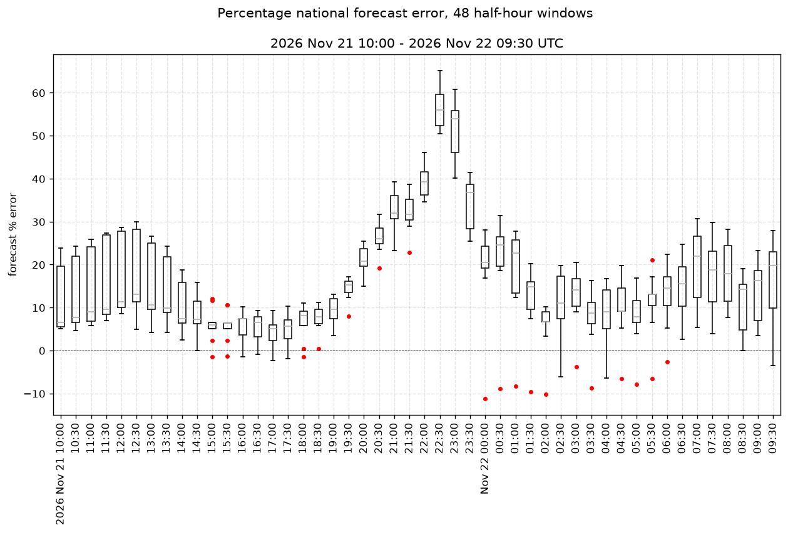
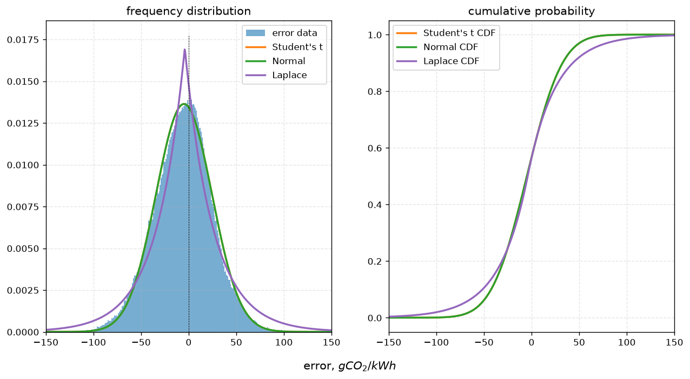

# Carbon Intensity Forecast Tracking

Tracking differences between the [UK grid's carbon intensity forecast](https://carbonintensity.org.uk/)
and its eventual recorded value.

## What is this?

See the accompanying [blog post](https://nickmp.com/posts/carbon-intensity-forecast-tracking).

The carbon intensity of electricity is a measure of the $CO_2$ emissions produced per
kilowatt-hour consumed. NESO publishes [an API](https://carbon-intensity.github.io/api-definitions/)
with half-hourly carbon intensity and a 48-hour forecast — but keeps no forecast history:
old forecasts are overwritten. This repo scrapes the API twice an hour from GitHub
Actions and commits what it sees, so the git history *is* the record, then publishes
daily accuracy statistics and charts.


Each half-hour window is forecast about 96 times over the preceding 48 hours and revised
for 24 hours afterwards; the fan above shows those trajectories converging.

## How it works

Everything lives in SQLite databases committed to the repo — no JSON or CSV data files
(design and measurements: [ADR-001](./docs/adr-001-sqlite.md)):

- **Twice hourly** (`ingest.yaml`): all five API endpoints are fetched in memory,
  validated, and written as one small inbox database (`data/db/inbox/snap_<slot>.sqlite`,
  ~130 KB).
- **Daily** (`daily.yaml`): complete days of inboxes fold into window-partitioned
  databases — `national_<YYYY-MM>` (full fidelity), `regional_<YYYY-MM>{a,b}` and
  `generation_<YYYY>` (change-log: a row is stored only when its values differ from the
  previous capture; recorded coverage makes reconstruction exact) — then every chart,
  the tables below, and `data/db/analysis.sqlite` are rebuilt.

## Forecast accuracy — national

### 24 hours




### Daily summaries

#### Absolute error, gCO2/kWh

<!-- cift:daily-stats:start -->
|            |   count |   mean |   sem |   95% CI low |   95% CI high |
|:-----------|--------:|-------:|------:|-------------:|--------------:|
| 2026-11-12 |     264 |  12.79 |  0.48 |        11.83 |         13.74 |
| 2026-11-13 |     434 |  14.62 |  0.63 |        13.39 |         15.86 |
| 2026-11-14 |     456 |  11.53 |  0.39 |        10.76 |         12.31 |
| 2026-11-15 |     459 |  21.73 |  0.95 |        19.87 |         23.6  |
| 2026-11-16 |     414 |  15.66 |  0.59 |        14.5  |         16.83 |
| 2026-11-17 |     347 |  24.07 |  1.13 |        21.85 |         26.3  |
| 2026-11-18 |     358 |   8.67 |  0.43 |         7.83 |          9.52 |
| 2026-11-19 |     156 |  18.18 |  0.81 |        16.57 |         19.79 |
<!-- cift:daily-stats:end -->

#### Absolute percentage error

<!-- cift:daily-stats-pc:start -->
|            |   mean |   sem |   95% CI low |   95% CI high |
|:-----------|-------:|------:|-------------:|--------------:|
| 2026-11-12 |  10.87 |  0.41 |        10.08 |         11.67 |
| 2026-11-13 |  10.73 |  0.48 |         9.79 |         11.66 |
| 2026-11-14 |  10.43 |  0.36 |         9.73 |         11.13 |
| 2026-11-15 |  16.61 |  0.64 |        15.36 |         17.86 |
| 2026-11-16 |  12.63 |  0.5  |        11.65 |         13.62 |
| 2026-11-17 |  20.96 |  0.94 |        19.1  |         22.81 |
| 2026-11-18 |   5.79 |  0.29 |         5.22 |          6.36 |
| 2026-11-19 |  10.87 |  0.5  |         9.87 |         11.86 |
<!-- cift:daily-stats-pc:end -->

### 30 days


### All data — absolute error

<!-- cift:all-data-summary:start -->
| n | mean | median | std | sem |
|---|---|---|---|---|
| 1398035 | 24.4260 | 20.0 | 19.6040 | 0.016580 |
<!-- cift:all-data-summary:end -->

## Forecast reliability



By fitting distributions to the error history we can estimate the probability of a
forecast error large enough to cross the published CI index bands (stored in
`data/db/reference.sqlite`).

#### Error magnitudes and their probabilities

<!-- cift:error-probabilities:start -->
|   error value |   Student's t probability |   Normal probability |   Laplace probability |
|--------------:|--------------------------:|---------------------:|----------------------:|
|           100 |                0.00394356 |          0.000768157 |             0.0341003 |
|            90 |                0.00779467 |          0.00246821  |             0.0478534 |
|            80 |                0.015369   |          0.00713402  |             0.0671534 |
|            70 |                0.0299931  |          0.0185754   |             0.0942374 |
|            60 |                0.0573808  |          0.043647    |             0.132245  |
|            50 |                0.106433   |          0.0927481   |             0.185581  |
|            40 |                0.189124   |          0.178701    |             0.260428  |
|            30 |                0.318152   |          0.313206    |             0.365463  |
|            20 |                0.50147    |          0.501382    |             0.51286   |
|            10 |                0.735247   |          0.736758    |             0.719704  |
<!-- cift:error-probabilities:end -->

The daily history of these statistics lives in `data/db/analysis.sqlite`
(`stats_history`, `error_probabilities`, `all_data_error_summary`).

## Usage

Expects Python 3.13+.

```sh
python3 -m venv venv && source venv/bin/activate
make install-dev        # or install / install-minimal
make check              # linters + the test suite

python run.py ingest  --db_root data/db                   # one snapshot now
python run.py compact --db_root data/db                   # fold complete days
python run.py analyse --db_root data/db --charts charts --readme README.md
```

The one-off historical migration (JSON/CSV era → SQLite) is `python run.py migrate`;
it stages every legacy source, emits through the production write path, and refuses to
pass unless an exhaustive verification gate — including reproducing the frozen 2023
README totals — holds.

## Runbook

- **Scheduled workflows** are auto-disabled by GitHub after 60 days without commits.
  Re-enable with `gh workflow enable ingest.yaml daily.yaml`. Failure emails go to
  whoever last edited the cron lines; failures and data-health alerts also open issues.
- **A missed scrape slot is permanently lost** (the API keeps no history); ~90% capture
  is normal and reconstruction treats gaps as gaps, never as unchanged values.
- **Backlog recovery**: if the daily job is down for a while, inboxes accumulate
  harmlessly; each daily run folds up to 600, oldest first — just let it catch up or
  dispatch it repeatedly.
- **Quarantine**: an inbox older than already-merged captures is moved to
  `data/db/inbox/quarantine/` rather than corrupting the change-log; inspect manually.
- **Size tripwire**: compaction fails loudly if a partition would exceed 85 MiB
  (GitHub blocks files at 100 MB); see ADR-001 before changing anything.

## Prior work

Kate Rose Morley's [grid.iamkate.com](https://grid.iamkate.com/) is the canonical live
view. NESO's [data portal](https://www.neso.energy/data-portal) publishes final values;
this project tracks the accuracy of forecasts *as they were published*.
